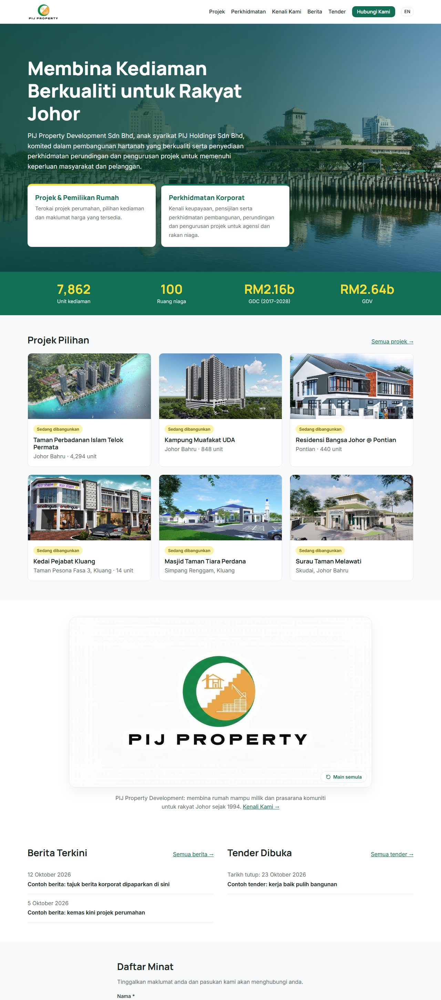
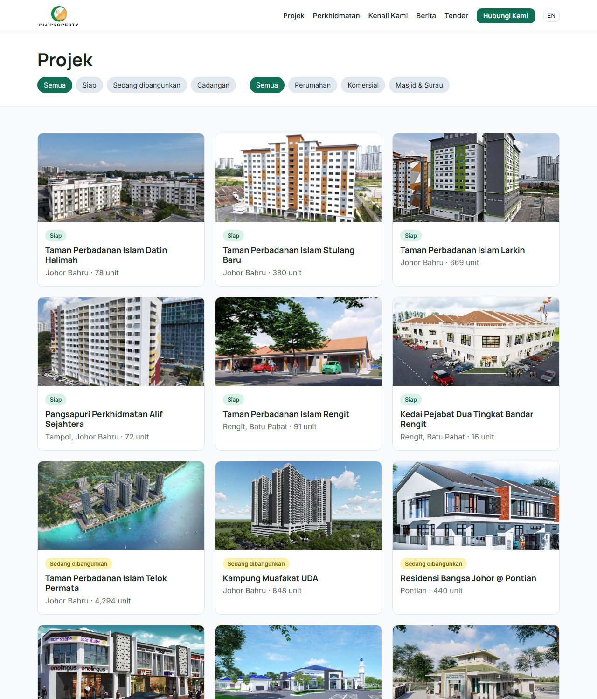
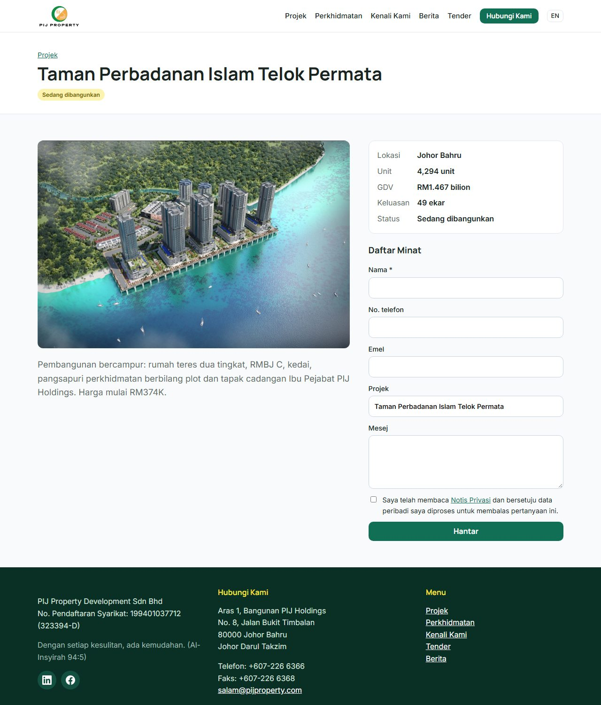
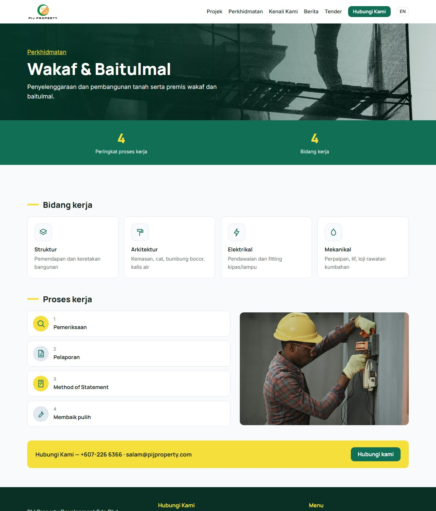
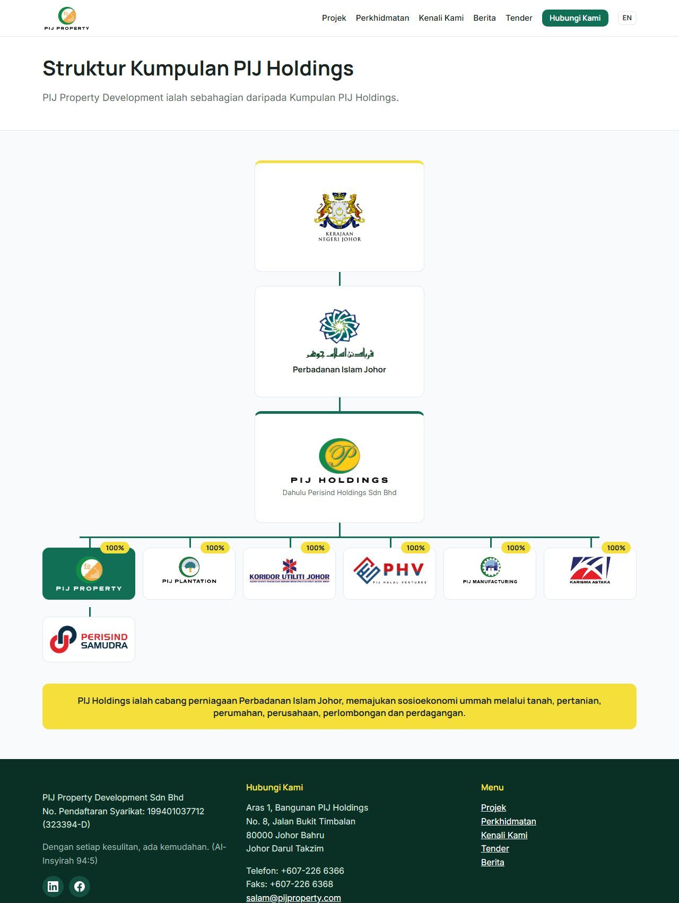
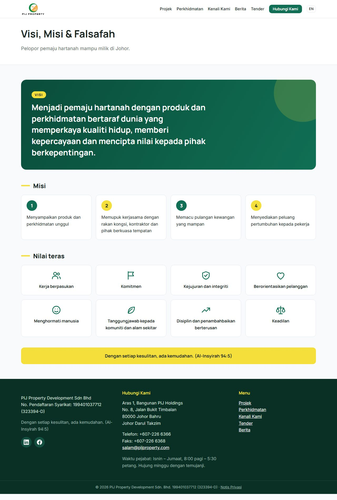
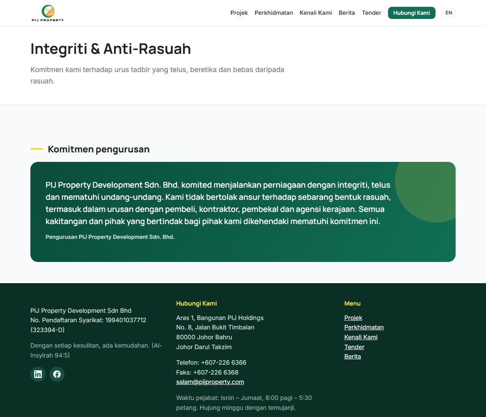
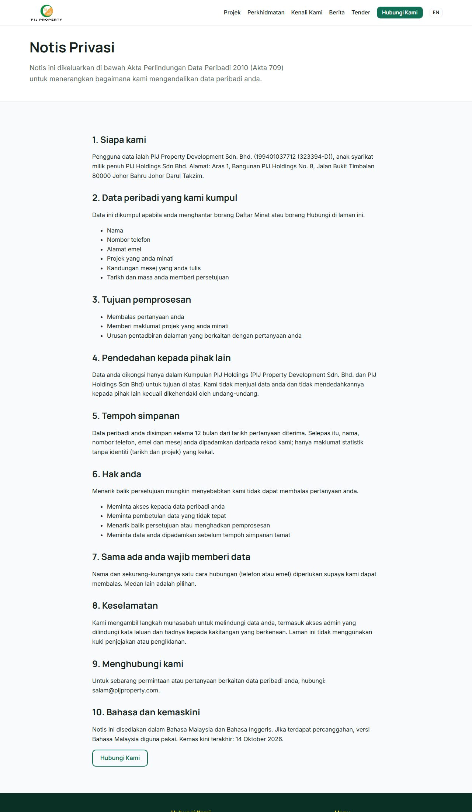
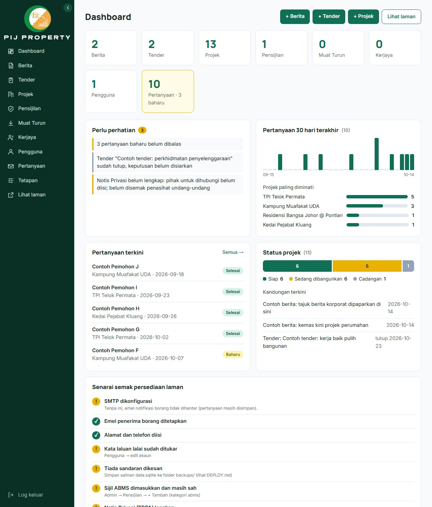
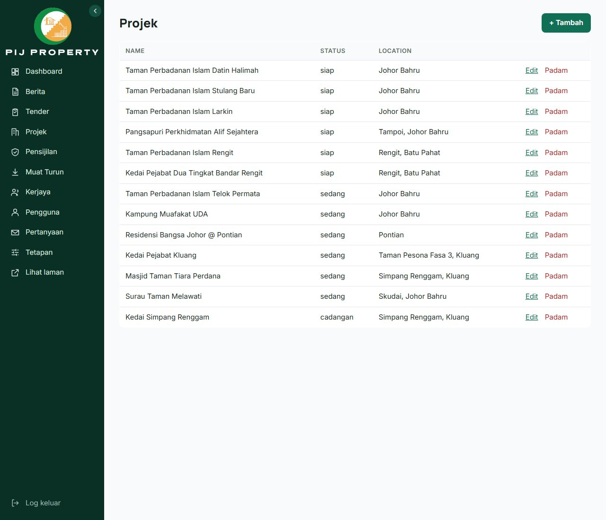

# PIJ Property: Laman Web Rasmi

Laman web korporat dwibahasa (BM / BI) untuk **PIJ Property Development Sdn. Bhd.** (anak syarikat PIJ Holdings), lengkap dengan panel admin untuk menguruskan kandungan tanpa menyentuh kod.

> Repositori ini peribadi (private). Aset korporat, imej projek dan video adalah hak milik PIJ Property Development Sdn. Bhd.



## Ciri-ciri

### Laman awam
- **Dua laluan di halaman utama**: *Projek & Pemilikan Rumah* dan *Perkhidmatan Korporat*.
- **Dwibahasa** (`/ms/...`, `/en/...`) dengan suis bahasa yang mengekalkan halaman semasa.
- **Projek**: senarai dengan penapis status/kategori, halaman butiran, borang daftar minat.
- **Perkhidmatan**: 5 halaman infografik (pembangunan hartanah, pengurusan projek, sekolah/masjid/surau, perumahan asnaf, wakaf & baitulmal).
- **Kenali Kami**: profil syarikat, visi/misi/falsafah, struktur kumpulan, pensijilan, integriti & anti-rasuah.
- **Menu dinamik**: Berita, Tender, Kerjaya dan Muat Turun hanya muncul bila ada rekod.
- **Video logo** pada halaman utama (main sekali bila diskrol) dan **video korporat** pada Profil Syarikat.
- **PDPA**: Notis Privasi (BM/BI), kotak persetujuan wajib pada borang, anonimkan data pertanyaan selepas 12 bulan.
- **Sijil luput disembunyikan secara automatik** daripada laman awam.

### Panel admin (`/admin`)
- Berita, Tender (dengan keputusan), Projek (galeri), Pensijilan, Muat Turun, Kerjaya, Pengguna.
- **Dashboard**: kiraan, perkara perlu perhatian, graf pertanyaan 30 hari, status projek, senarai semak persediaan laman.
- Pertanyaan pembeli dengan status (baharu / dihubungi / selesai) dan eksport CSV.
- Sidebar boleh dilipat, tetapan syarikat, PDPA dan media sosial.
- Log masuk dengan bcrypt, had percubaan, token CSRF.

## Tangkapan skrin

| | |
|---|---|
|  **Senarai projek** |  **Butiran projek + daftar minat** |
|  **Perkhidmatan (infografik)** |  **Struktur kumpulan** |
|  **Visi, misi & falsafah** |  **Integriti & anti-rasuah** |
|  **Notis Privasi (PDPA)** | |

### Admin

| | |
|---|---|
|  **Dashboard** |  **Pengurusan projek** |

> Berita, tender dan pertanyaan dalam tangkapan skrin ialah **data contoh** yang berlabel "Contoh", bukan rekod sebenar.

## Teknologi

| | |
|---|---|
| Runtime | Node.js 22.5+ |
| Pelayan | Express 5 |
| Pangkalan data | SQLite melalui `node:sqlite` (tiada pengkompilan natif) |
| Paparan | EJS, dirender di pelayan (tiada langkah build) |
| Lain-lain | bcryptjs, express-session, multer, nodemailer, express-rate-limit |
| Fon | Inter dan Manrope, dihoskan sendiri (tiada permintaan ke Google) |

## Bermula (pembangunan)

```bash
npm install
npm start          # http://localhost:3000
npm test           # smoke test
```

Pada **run pertama**, kata laluan admin dijana dan dipaparkan sekali dalam log:

```
[first run] Admin login: admin@pijproperty.com  password: ********
```

Tukar kata laluan itu di **Admin → Pengguna** sebelum sebarang pelancaran.

### Pemboleh ubah persekitaran

| Nama | Fungsi |
|---|---|
| `PORT` | Port pelayan (lalai `3000`) |
| `SESSION_SECRET` | Rahsia sesi, rentetan rawak yang panjang |
| `ADMIN_EMAIL`, `ADMIN_PASSWORD` | Akaun admin pertama (run pertama sahaja) |
| `SMTP_HOST`, `SMTP_PORT`, `SMTP_USER`, `SMTP_PASS`, `MAIL_FROM` | Hantar emel notifikasi borang. Tanpa `SMTP_HOST`, pertanyaan tetap disimpan dalam admin. |
| `DB_FILE` | Laluan fail SQLite (pilihan) |
| `NODE_ENV=production` | Kuki sesi `secure` (wajib di belakang HTTPS) |

Contoh dalam [`.env.example`](.env.example).

## Struktur projek

```
src/
  server.js            Wiring Express, sesi, 404/500
  db.js                Skema SQLite, migrasi ringan, data awal
  i18n.js              Teks UI BM/BI
  content.js           Halaman statik (Kenali Kami)
  services-data.js     Data infografik perkhidmatan
  privacy-content.js   Teks Notis Privasi (draf)
  integrity-content.js Teks halaman Integriti
  retention.js         Anonimkan pertanyaan > 12 bulan
  menu.js              Bendera menu dinamik
  routes/public.js     Laman awam + borang
  routes/admin.js      Admin: CRUD, dashboard, tetapan
views/                 Templat EJS (awam + admin)
public/                CSS, fon, imej, media (video)
scripts/smoke.js       Ujian asap (tanpa framework)
docs/                  Spesifikasi, pelan, tangkapan skrin
```

## Kandungan yang perlu dilengkapkan sebelum pelancaran

- **Notis Privasi**: disemak penasihat undang-undang; isi pihak untuk dihubungi (Admin → Tetapan).
- **Sijil ABMS**: masukkan di Admin → Pensijilan (kategori `abms`).
- **Komitmen anti-rasuah**: semak teks draf di Admin → Tetapan.
- **Gambar projek**: ganti pemegang tempat dengan foto rasmi.
- **SMTP, kata laluan admin, sandaran**: lihat senarai semak di Dashboard.

## Pelancaran

Panduan pelayan (Nginx, HTTPS, sandaran, PDPA) ada dalam [DEPLOY.md](DEPLOY.md).

## Dokumen reka bentuk

- Spesifikasi: [`docs/superpowers/specs/`](docs/superpowers/specs/)
- Pelan pelaksanaan: [`docs/superpowers/plans/`](docs/superpowers/plans/)
- Kredit imej sementara (Unsplash): [`public/img/s/CREDITS.md`](public/img/s/CREDITS.md)
